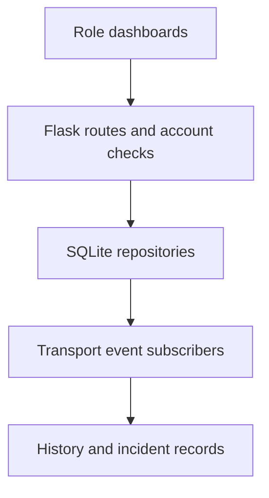

# BloodTransport technical specification

The application demonstrates fictional sample transport between a dispatcher, a courier, and a laboratory.

| Role | Acceptance criteria |
| --- | --- |
| Dispatcher | Create plans with sample type, route, count, contacts and deadlines. Assign, reassign, edit or cancel before pickup. Review history, resolve issues and export the filtered list. |
| Courier | See assigned requests, record pickup and delivery in order, and leave notes or report delays. |
| Laboratory | See inbound requests for its location, filter by stage and type, accept delivery or document a receipt issue. |

## API

The collection is `/api/transport-requests`. Mutations require a session and CSRF token.

| Request | Behaviour |
| --- | --- |
| GET or POST collection | Read scoped transports or create a new plan as dispatcher |
| GET or PATCH `/<id>` | Read request or update an editable plan using its revision |
| POST `/<id>/assign` or `/<id>/cancel` | Assign a courier or cancel with a reason before pickup |
| PATCH `/<id>/status` | Assigned courier records pickup or delivery |
| POST `/<id>/receipt` | Destination laboratory confirms receipt |
| GET `/<id>/history` | Read the request timeline and issues |
| POST `/<id>/incidents` | Add an issue to a visible request |
| PATCH `/<id>/incidents/<incident-id>/resolve` | Dispatcher resolves an open issue |

SQLite stores accounts, transport requests, status history and issues. Status, history and receipt issues are updated in one transaction. The current revision prevents stale user actions from overwriting changes.

The workspace tools group role-scoped data into a daily planner, an incident centre and printable QR labels. A QR label contains a tracking URL. The tracking page applies the same login and access rules as the request API.

## Patterns used by the application

| Pattern | Code | Application |
| --- | --- | --- |
| Factory | `create_app`, `src/app.py` | Creates isolated Flask instances for tests and the server. |
| Repository | `src/repository.py`, `src/accounts.py` | Encapsulates SQLite queries and transactions. |
| Strategy | `queueOrdering`, `src/static/dispatcher.js` | Selects newest, priority, or deadline ordering. |
| Adapter | `requestsToCsv`, `src/static/dispatcher.js` | Adapts transport objects to CSV columns and escapes spreadsheet fields. |
| Observer | `publish_transport_event`, `src/transport_events.py` | Status changes notify history and incident subscribers in the same transaction. |
| Singleton (module-level policy) | `NEXT_STATUS`, `src/workflow.py` | Application instances within a process share one immutable transition map. |
